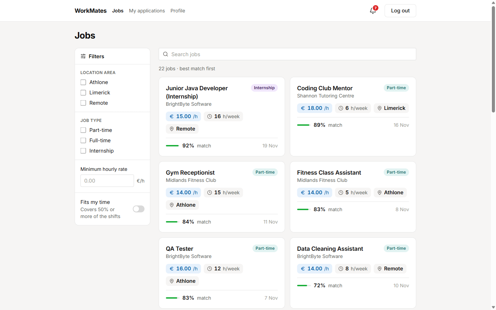
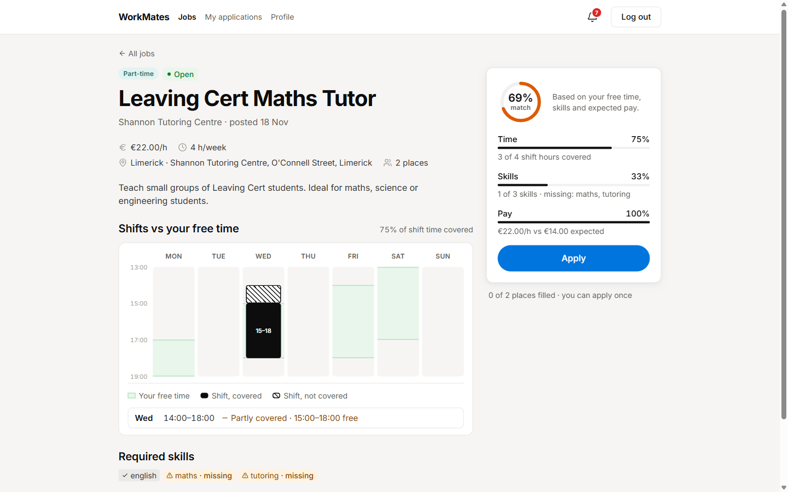
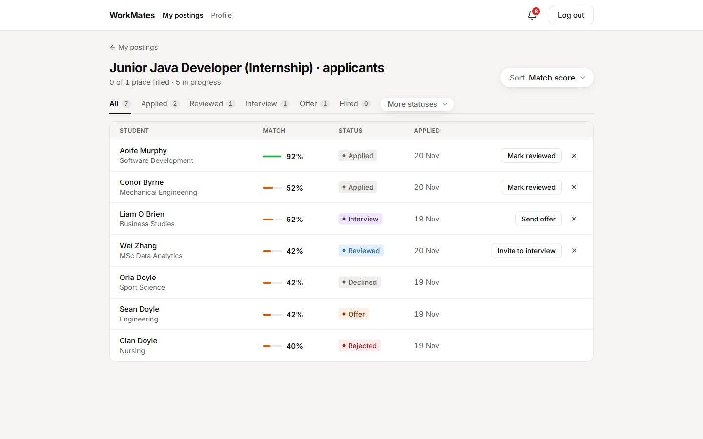
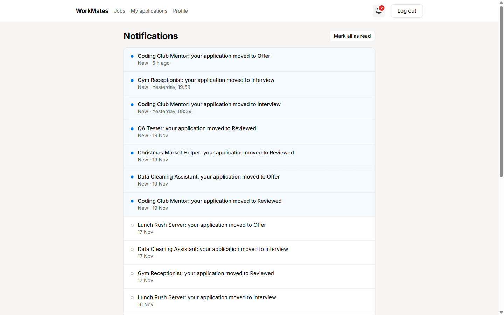
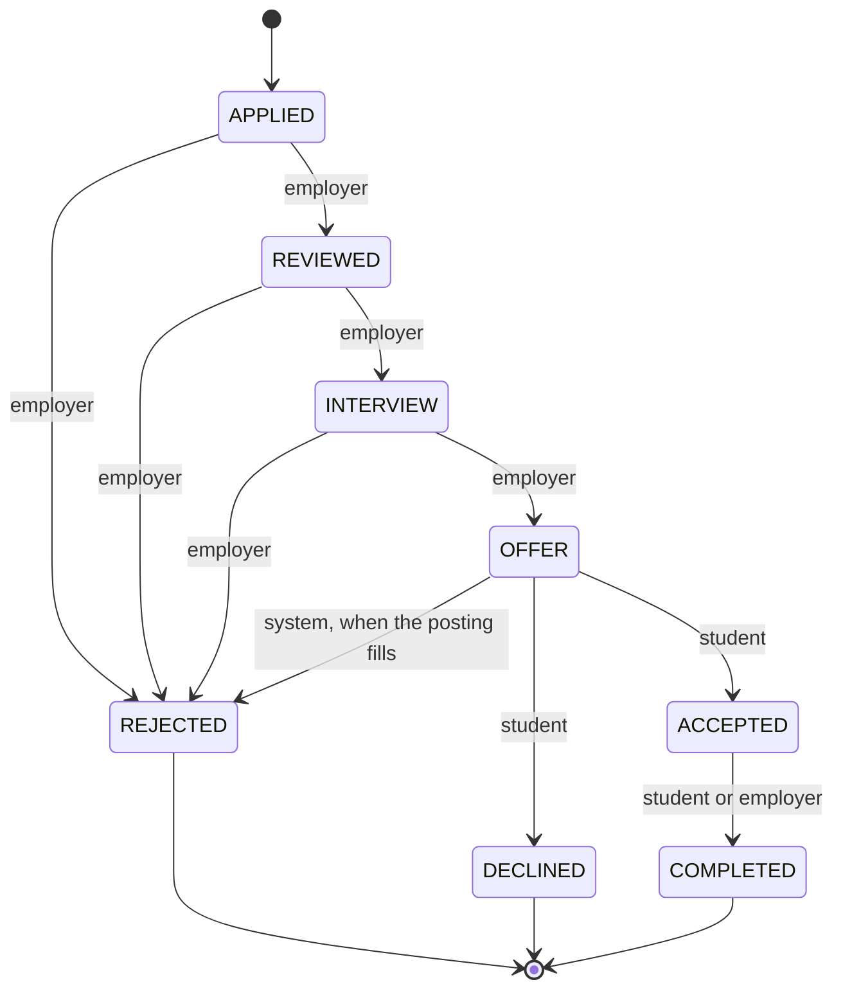
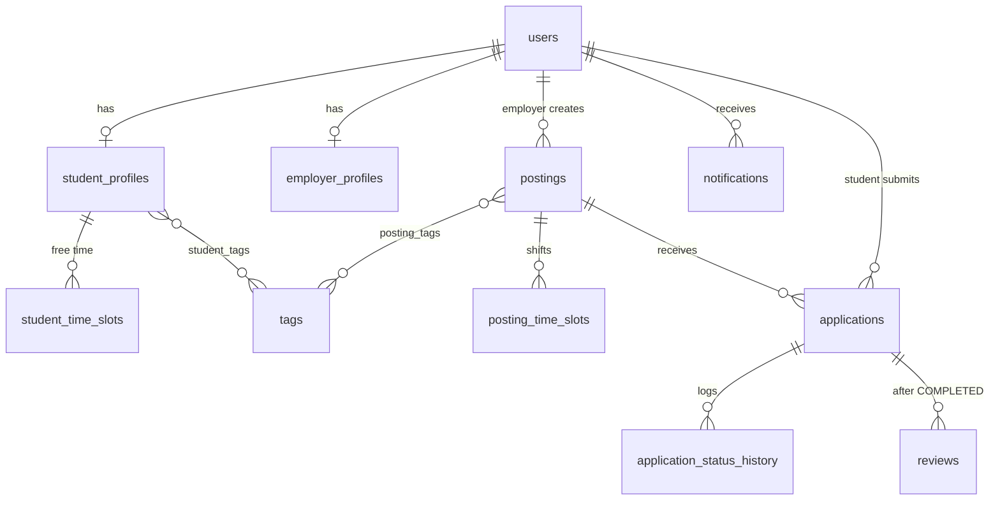

# WorkMates 🧑‍🎓💼

[](https://github.com/shining319/WorkMates/actions/workflows/ci.yml)


> Stop scrolling through 37 WhatsApp groups to find a part-time job.

WorkMates is a part-time and full-time job community for students at our university.

## 😩 Job hunting right now

- Postings are scattered across WhatsApp, Facebook, and endless job groups. Good luck scrolling.
- You finally find one, and the shift lands on your fully booked Wednesday.
- Will the boss pay on time? Flip a coin.

## ✨ What WorkMates does about it

- 📋 **Every job in one place**: hourly rate, hours, and location, spelled out
- 🎓 **Campus email sign-up**: real students and real employers only
- 🗓️ **Matched to your free time**: jobs that don't clash with your timetable come first
- 🔔 **Live application updates**: no more waiting in the dark
- ⭐ **Two-way reviews** (coming soon): you rate whether the boss pays on time, the boss rates whether you show up on time

## 📸 Screenshots

| Jobs ranked by match score | Match breakdown for one job |
| --- | --- |
|  |  |
| **Employer's applicant list** | **Notification centre** |
|  |  |

## 🧩 Features

The MVP is done: everything below works end to end.

**Students**

- Sign up with an `@student.tus.ie` email.
- Keep one profile (skills, expected hourly pay, weekly free time slots) and reuse it for every application.
- Browse and search jobs, filter by area, job type, minimum pay, and "fits my time".
- See jobs ranked by a match score: the average of time fit, skill fit, and pay fit. The job page explains each part.
- Apply in one click, track every application and its history, and accept or decline offers.

**Employers**

- Sign up with any other email and fill in a company profile.
- Create, edit, and close postings with structured fields (pay, hours, location, shifts, skills, headcount).
- Review applicants sorted by match score, move them through the pipeline, or reject them.
- A posting closes by itself when its headcount fills, and the system rejects the remaining open applications.

**Both** can mark an accepted job as completed, and both get in-app notifications whenever an application changes status.

### Application status flow

Only `ApplicationStateMachine` may change a status.



`ACCEPTED` and `COMPLETED` count toward a posting's headcount. When a posting fills, the system also rejects any application still at `APPLIED`, `REVIEWED`, or `INTERVIEW`.

## 🛠️ Tech stack

| Layer | Tools |
| --- | --- |
| Backend | Java 21, Spring Boot 3.5 (Web, Data JPA, Validation), MapStruct, Lombok, jjwt + BCrypt, springdoc-openapi |
| Frontend | React 19, TypeScript, Vite, Tailwind CSS 4, Redux Toolkit + RTK Query, React Router 7, React Hook Form + Zod, sonner |
| Database | PostgreSQL 18 |
| Testing | JUnit 5, Mockito, JaCoCo |
| Delivery | GitHub Actions, Docker, GitHub Container Registry, Nginx on one VPS |

## 📁 Project structure

```
WorkMates/
├── backend/WorkMates/   Spring Boot app (base package com.workmates)
│   └── src/main/java/com/workmates/
│       ├── account/       register and login
│       ├── profile/       student and employer profiles, tags, free time slots
│       ├── posting/       job postings
│       ├── matching/      match score calculation
│       ├── application/   applications and the status state machine
│       ├── notification/  in-app notifications
│       └── common/        error handling, JWT auth and roles, time slot rules, config
├── frontend/            React SPA
│   └── src/
│       ├── app/           router, store, layouts, role guard
│       ├── api/           RTK Query base API and shared types
│       ├── features/      auth, jobs, postings, applications, notifications, profile
│       └── shared/        UI components and helpers
├── db/                  schema.sql and demo-data.sql
├── deploy/              Dockerfiles, docker-compose.yml, nginx.conf
└── .github/workflows/   ci.yml and deploy.yml
```

## 🗄️ Database

The backend never creates tables. Hibernate runs with `ddl-auto: validate`, so the app refuses to start if the tables do not match the entities. Create them with [`db/schema.sql`](db/schema.sql).

| Module | Tables |
| --- | --- |
| account | `users`: login accounts, role `STUDENT` or `EMPLOYER` |
| profile | `student_profiles`, `employer_profiles` (1:1 with `users`), `tags`, `student_tags`, `student_time_slots` |
| posting | `postings`, `posting_tags`, `posting_time_slots` |
| application | `applications` (one per student per posting), `application_status_history` |
| notification | `notifications` |
| review | `reviews` (table ready, feature coming soon) |



The schema has no foreign key constraints; the services check these links in code.

[`db/demo-data.sql`](db/demo-data.sql) loads fake accounts, postings, applications in every status, and notifications. The header of that file lists every account and the scenario each one is meant to show.

## 🚀 Getting started

### Prerequisites

- Java 21
- Node 24 (see `frontend/.nvmrc`) and npm
- PostgreSQL 18 (any recent version should work)

### 1. Create the database

```bash
createdb -U postgres workmates
psql -U postgres -d workmates -f db/schema.sql
psql -U postgres -d workmates -f db/demo-data.sql   # optional: demo data
```

> ⚠️ `demo-data.sql` **deletes every row in every table** of the database it runs against before loading the demo data. Only run it against a local database. Run it again any time you want a clean reset.

### 2. Run the backend

The `local` profile has a default for every setting. Override any of them with an environment variable:

| Variable | Purpose | Local default |
| --- | --- | --- |
| `SPRING_PROFILES_ACTIVE` | `local` or `prod` | `local` |
| `DB_URL` | JDBC URL | `jdbc:postgresql://localhost:5432/workmates` |
| `DB_USERNAME` | database user | `workmates` |
| `DB_PASSWORD` | database password | `workmates` |
| `JWT_SECRET` | Base64 key, at least 32 bytes | a dev-only key in `application-local.yml` |
| `JWT_TTL` | how long a login lasts, e.g. `7d`, `12h` | `7d` |

The `prod` profile has no defaults, so every variable must be set.

```bash
cd backend/WorkMates
DB_USERNAME=postgres DB_PASSWORD=<your password> ./mvnw spring-boot:run   # use mvnw.cmd on Windows
```

The API runs on `http://localhost:8080`. Swagger UI is at `http://localhost:8080/swagger-ui.html`.

### 3. Run the frontend

```bash
cd frontend
npm install
npm run dev
```

Open `http://localhost:5173`. Vite proxies `/api` to the backend on port 8080.

### Demo accounts

If you loaded `demo-data.sql`, every account uses the password `Demo1234`. A few good starting points:

| Account | What you will see |
| --- | --- |
| `aoife.murphy@student.tus.ie` | Main demo student: complete profile, one application in every status |
| `sophie.walsh@student.tus.ie` | Student with an empty profile (empty states, 0% matches) |
| `brightbyte@example.com` | Employer with five open postings and applicants at many stages |
| `lakeside.cafe@example.com` | Employer with a closed posting and a filled posting |

## 🧪 Testing and CI

```bash
# backend: unit tests + coverage report at target/site/jacoco/index.html
cd backend/WorkMates && ./mvnw test

# frontend: lint, then type check and production build
cd frontend && npm run lint && npm run build
```

Backend tests are plain unit tests with Mockito and never touch a database.

`.github/workflows/ci.yml` runs both jobs on every pull request to `dev`, `test`, or `main`, and uploads the JaCoCo report as an artifact.

## 📦 Deployment

```
push to test ──► deploy.yml ──► build backend + frontend images ──► GHCR
                                                                  │
                     VPS: docker compose pull && up -d ◄──────────┘
                     host Nginx ──► frontend container (SPA)
                                └──► /api ──► backend container ──► PostgreSQL on the host
```

Code flows `feature → dev → test → main`, each step through a pull request. Pushing to `test` triggers `.github/workflows/deploy.yml`, which builds both Docker images, pushes them to GitHub Container Registry, and restarts the containers on the VPS. The Dockerfiles, `docker-compose.yml`, and the frontend container's Nginx config are in [`deploy/`](deploy/).

## 🗺️ Roadmap

- ⭐ Two-way reviews after a job is completed, shown on profiles
- 🔔 Notifications for newly posted jobs that match a student, with an on/off switch
- ✅ Bulk status changes for employers with many applicants
